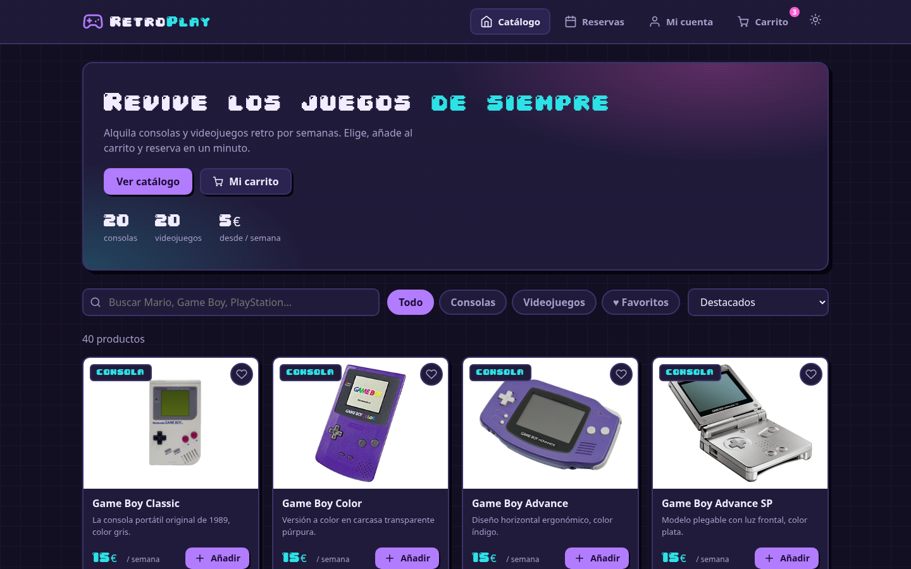
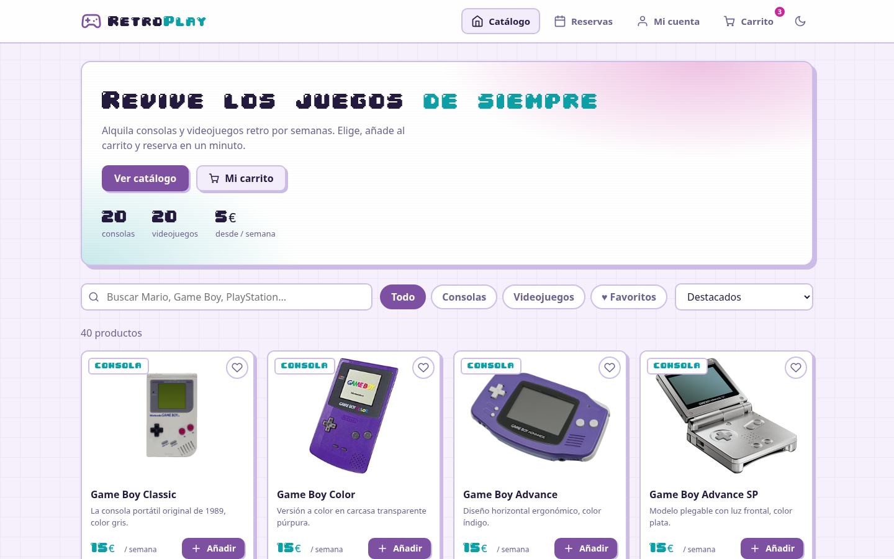
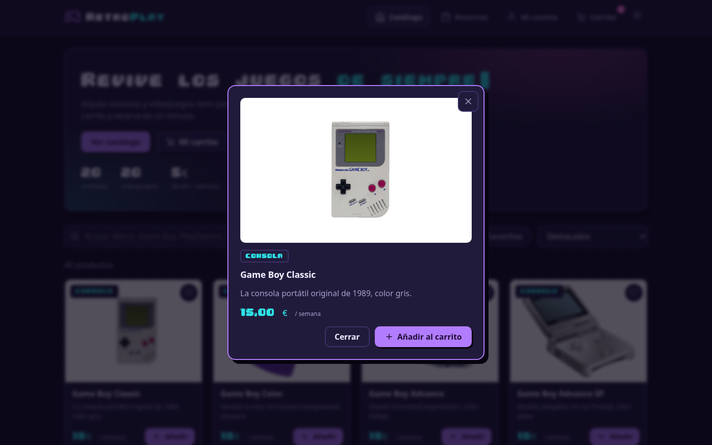
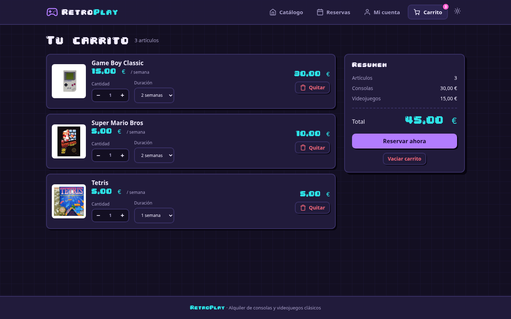
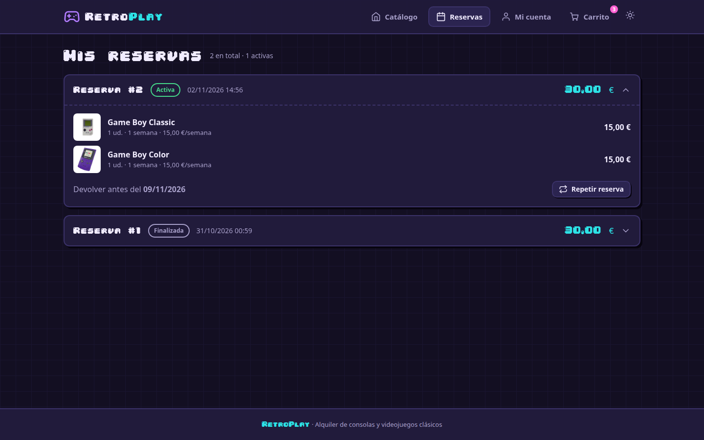
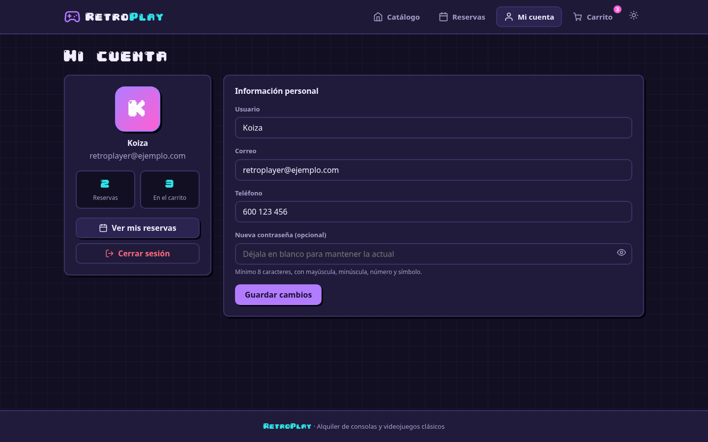
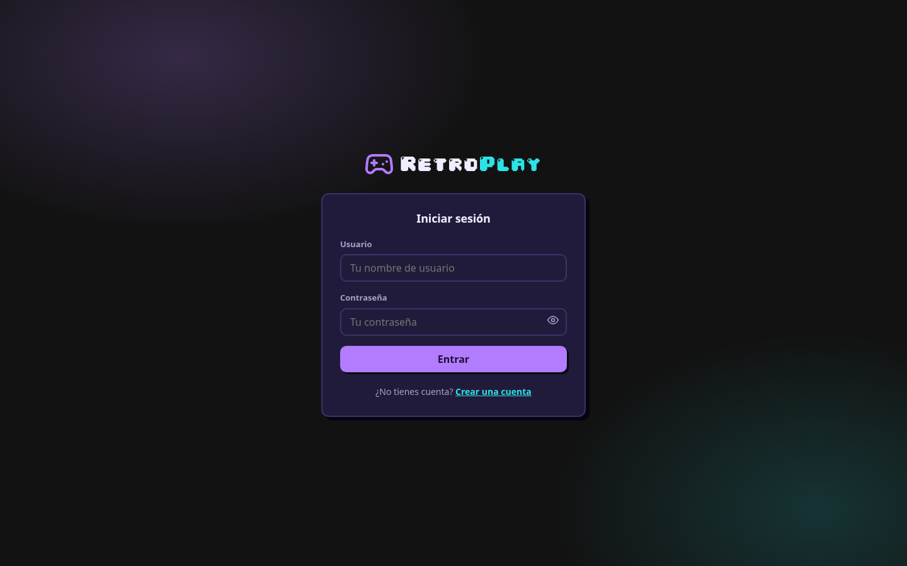
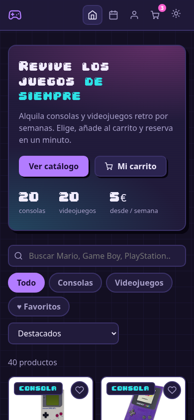
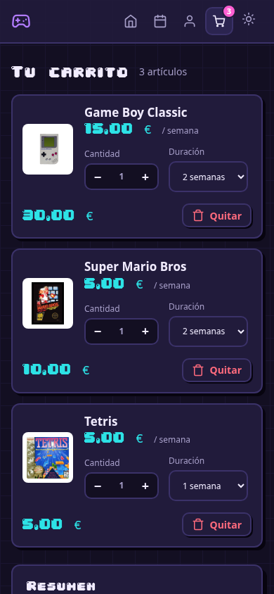

# Retroplay

Retroplay es una aplicación web para el alquiler de consolas y videojuegos retro. Redescubre los clásicos con nuestra colección de hardware y software vintage.

## Características

- **Explorador de catálogo**: Explora una amplia selección de consolas retro (Game Boy, NES, PlayStation, etc.) y videojuegos.
- **Cuentas de usuario**: Regístrate e inicia sesión para gestionar tus alquileres.
- **Carrito de compras**: Carrito real con cantidades, duración del alquiler en semanas, precios por línea y totales, persistido en el navegador; el proceso de pago crea una reserva (los precios se recalculan en el servidor).
- **Búsqueda, filtros y favoritos**: Búsqueda en vivo, chips de categorías, ordenamiento, modal de detalles de productos y favoritos.
- **Tema claro / oscuro**, animaciones (efecto de vuelo al carrito, notificaciones *toasts*, aparición al desplazar) y un botón de "repetir reserva".
- **Reservas**: Realiza pedidos de alquiler y consulta tu historial de reservas.
- **Diseño responsivo**: Accesible en varios dispositivos.

## Capturas de pantalla

### Catálogo

Tema oscuro (por defecto) y tema claro, con búsqueda en vivo, filtros por categoría, favoritos y ordenación.

| Tema oscuro | Tema claro |
|:---:|:---:|
|  |  |

### Detalle de producto y carrito

| Detalle de producto | Carrito |
|:---:|:---:|
|  |  |

### Reservas y cuenta

| Mis reservas | Mi cuenta |
|:---:|:---:|
|  |  |

### Acceso



### Versión móvil

| Catálogo | Carrito |
|:---:|:---:|
|  |  |

## Estructura del Proyecto

El proyecto está organizado de la siguiente manera:

- **`back/`**: Contiene la lógica del backend.
  - `Conexion_BD/`: Scripts de conexión a la base de datos.
  - `Procesar/`: Lógica de procesamiento (registro, login, reservas, perfil).
  - `Validadores/`: Validación de contraseñas.
- **`front/`**: Contiene las páginas y recursos del frontend.
  - `assets/`: CSS compartido (`css/retroplay.css`), JS (`js/`), fuentes e imágenes de productos.
  - `includes/layout.php`: Cabecera, navegación y pie de página compartidos.
  - `inicio/`: Página principal de bienvenida y catálogo de productos.
  - `login/`: Página de inicio de sesión de usuario.
  - `registro/`: Página de registro de usuario.
  - `carrito/`: Página del carrito de compras.
  - `mi_cuenta/`: Gestión de la cuenta de usuario.
  - `mis_reservas/`: Historial de reservas del usuario.
- **`BBDD/`**: Scripts de inicialización de la base de datos.
  - `setup.sql`: Script SQL para crear la base de datos y las tablas, e insertar los datos iniciales.

## Tecnologías Utilizadas

- **Backend**: PHP
- **Base de datos**: MySQL
- **Frontend**: HTML, CSS, JavaScript

## Instrucciones de Configuración

### Prerrequisitos

- Un servidor web (por ejemplo, Apache, Nginx) con compatibilidad para PHP.
- Servidor de base de datos MySQL.

### Instalación

1. **Clonar el repositorio**:
   ```bash
   git clone <repository_url>
   ```

2. **Configuración de la Base de Datos**:
   - Crea una base de datos MySQL (o deja que el script lo haga).
   - Importa el archivo `BBDD/setup.sql` en tu servidor MySQL. Esto creará la base de datos `retroplay`, las tablas e insertará datos de ejemplo.
   - El script crea un usuario `retroplay` con la contraseña `Retroplay123$`. Si deseas utilizar credenciales diferentes, actualiza `back/Conexion_BD/conexion.php`.

3. **Configuración**:
   - Asegúrate de que tu servidor web esté configurado para servir la raíz del proyecto.
   - Revisa `back/Conexion_BD/conexion.php` para asegurarte de que las credenciales de la base de datos coincidan con tu entorno.

   ```php
   $conexion = mysqli_connect("localhost", "retroplay", "Retroplay123$", "retroplay");
   ```

4. **Ejecución de la Aplicación**:
   - Inicia tu servidor web.
   - Navega a `http://localhost/retroplay/front/inicio/inicio.php` (ajusta la ruta según la configuración de tu servidor).

## Uso

1. **Registrarse**: Crea una nueva cuenta en la sección de registro.
2. **Explorar**: Explora el catálogo de consolas y juegos en la página principal.
3. **Alquilar**: Añade artículos a tu carrito y procede al pago para crear una reserva.
4. **Gestionar**: Consulta tus reservas en la sección "Mis Reservas".

## Autores

Sara Monzó y Piero Funes